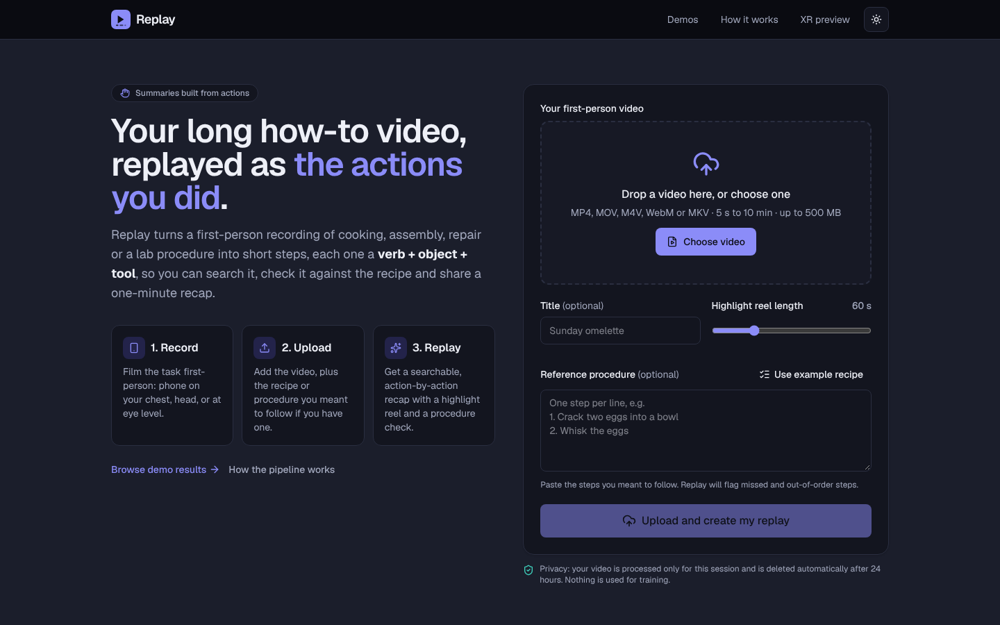
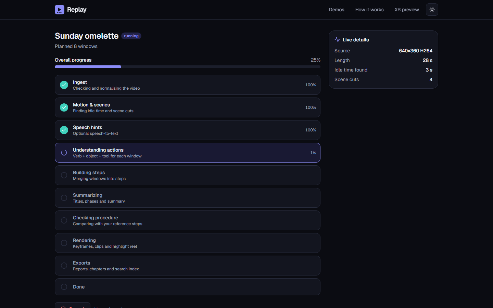
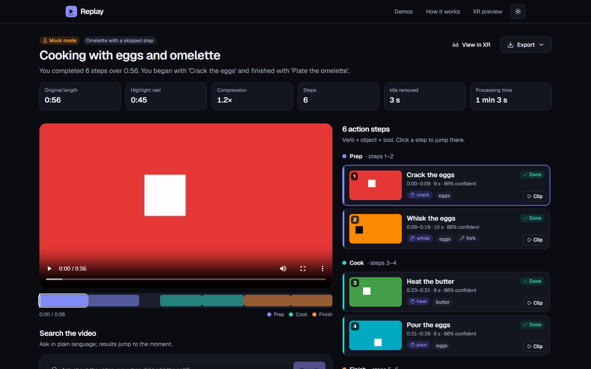
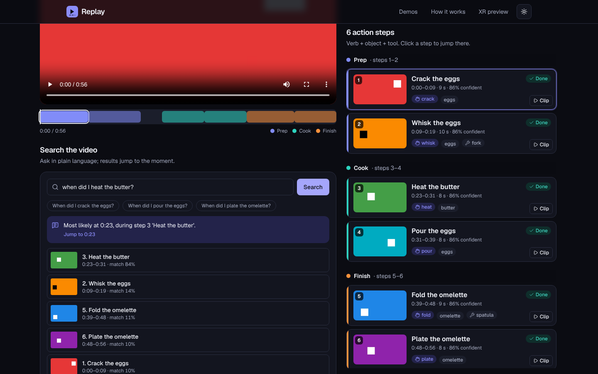
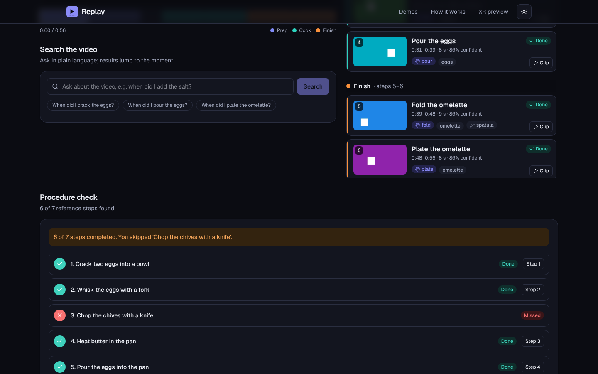
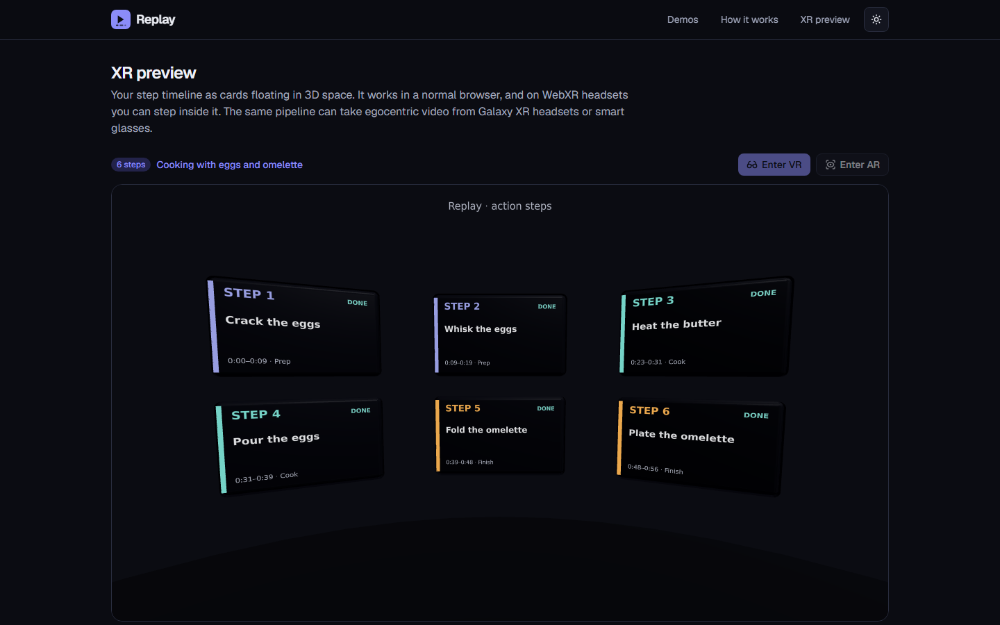
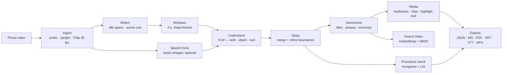

# Replay: action-aware video summarization

**Replay turns a long first-person phone video of a hands-on task (cooking, assembly, repair,
a lab procedure) into a short, searchable, action-by-action recap.** Unlike scene-change or
transcript-based summarisers, it organises everything around **actions: verb + object + tool**
("chop · onion · knife"). That's what makes the recap searchable by what you *did*, lets it
flag the steps you **missed or did out of order** against your recipe, and produces a captioned
one-minute highlight reel.

Built by **Team Astra** (Thapar Institute of Engineering and Technology) for the **Samsung PRISM
XR Hackathon**, track 4, *Action Aware Video Summarization*. Source:
[github.com/yajya18/astra-replay](https://github.com/yajya18/astra-replay).

| Team Astra | |
|---|---|
| Yajya Arora | Sandhi Gahlot |
| Hardik Jain | Durva |

| Upload | Live processing | Results |
|---|---|---|
|  |  |  |
| **Search** | **Procedure check** | **XR preview** |
|  |  |  |

*Screenshots show the three bundled demos. Their footage is synthetic (colour blocks), rendered
in mock mode; see "Screenshots" below to retake them with your own recordings.*

## Features

- **Upload from any phone**: drag-and-drop or tap to select; preview, duration and size checked in the browser. Portrait (rotation metadata), HEVC, variable frame rate and no-audio videos are handled. Limits: 5 s to 10 min, 500 MB.
- **Action-aware pipeline**: idle-time removal from the video's own motion curve, cut-aware 4 s windows with sharp frame selection, a vision-language model returning strict JSON (`verb`, `object`, `tool`, `hands`, `description`, `confidence`), then merging into steps.
- **Results page**: player with phase-coloured chapter timeline and WebVTT chapters/captions; step cards (keyframe, title, chips, time, confidence, alignment badge, clip player); the active step follows playback.
- **Natural-language search**: hybrid semantic + keyword scoring; one-sentence answers that cite a timestamp ("You chopped the chives at 0:16…").
- **Procedure check**: paste your recipe; Hungarian matching + longest-increasing-subsequence ordering → *done / missed / out of order*, with a plain-language verdict.
- **Highlight reel**: about 60 s (20–180 s, configurable), √duration time budgets, burned-in captions, title and closing cards, crossfades.
- **Exports**: JSON (versioned schema), Markdown, PDF (with keyframes and the alignment table), SRT and WebVTT chapters, MP4.
- **Under the hood** panel: pipeline diagram, stage timings, providers, motion curve, and the raw window-level actions.
- **XR preview**: the step timeline as 3D cards (React Three Fiber), enterable in VR/AR through WebXR.
- **Works with zero API keys**: the deterministic `mock` provider keeps the demo and tests offline; results are labelled "Mock mode".
- **Swappable providers**: Gemini, OpenAI, Anthropic Claude, or a local model through Ollama.

## Architecture



More detail in [docs/ARCHITECTURE.md](docs/ARCHITECTURE.md). Design choices and deviations from
the spec are listed in [docs/DECISIONS.md](docs/DECISIONS.md).

## Quickstart

### Docker (one command)

```bash
cp .env.example .env        # optional: add an API key and pick a provider
docker compose up --build
```

Open <http://localhost:3000>. The API runs on <http://localhost:8000> (OpenAPI docs at `/docs`).
On first start the backend renders and processes the three demo videos in the background;
they appear in the gallery within a few minutes.

### Local development

Requirements: **Python 3.11+** with [uv](https://docs.astral.sh/uv/), **Node 20.9+**,
**ffmpeg/ffprobe** on your `PATH` (`winget install Gyan.FFmpeg`, `brew install ffmpeg` or
`apt install ffmpeg`) and **GNU make** (on Windows: `winget install ezwinports.make`, then run
make from Git Bash).

```bash
make setup     # backend deps (uv), frontend deps (npm), Playwright Chromium, local models
make dev       # API on :8000 and web app on :3000
```

Without make:

```bash
cd backend && uv sync --all-extras && uv run uvicorn app.main:app --reload --port 8000
cd frontend && npm install && npm run dev
```

**Uploading from your phone:** open `http://<your-laptop-ip>:3000` on the same Wi-Fi. The app
calls the API on the same host at port 8000, and private-network origins are allowed by CORS.

## Configuration

All settings are environment variables (or a `.env` file in the repo root or `backend/`);
[.env.example](.env.example) lists every one with its default. The most important:

| Variable | Default | Meaning |
|---|---|---|
| `VLM_PROVIDER` | `mock` | Vision provider for window understanding: `mock`, `gemini`, `openai`, `anthropic`, `ollama` |
| `LLM_PROVIDER` | `mock` | Text provider for titles, verification and search answers |
| `GEMINI_API_KEY` / `OPENAI_API_KEY` / `ANTHROPIC_API_KEY` | (empty) | Keys, read from the environment only |
| `*_VLM_MODEL`, `*_LLM_MODEL` | see `.env.example` | Model names per provider |
| `ANTHROPIC_EFFORT` | `low` | Effort level for Claude calls |
| `OLLAMA_HOST` | `http://localhost:11434` | Local Ollama server |
| `PROVIDER_CONCURRENCY` | `4` | Parallel VLM calls |
| `EMBEDDING_MODEL` | `all-MiniLM-L6-v2` | Local sentence-transformers model (`EMBEDDING_BACKEND=hash` for a fully offline fallback) |
| `WHISPER_ENABLED`, `WHISPER_MODEL` | `true`, `small` | Optional speech hints with faster-whisper |
| `MAX_UPLOAD_MB`, `MAX_DURATION_S`, `MIN_DURATION_S` | `500`, `600`, `5` | Upload limits |
| `HIGHLIGHT_SECONDS` | `60` | Default reel length (20–180) |
| `RETENTION_HOURS` | `24` | Uploaded jobs are deleted after this; demos are kept |
| `DATA_DIR`, `DEMO_DIR` | `data`, `demo` | Storage and demo folders |
| `NEXT_PUBLIC_API_URL` | (empty) | Frontend build-time API URL; empty = same host, port 8000 |

### Switching providers and models

```bash
# .env
VLM_PROVIDER=gemini
LLM_PROVIDER=gemini
GEMINI_API_KEY=...
```

Restart the backend; the active provider and model are logged at startup and shown by
`GET /api/health` and in the results page's "Under the hood" panel. **Model names change
often.** The defaults (`gemini-flash-latest`, `gpt-5.4-mini`, `claude-opus-5-5`,
`qwen2.5vl:7b`) live in `backend/app/config.py` and `.env.example`; override them with
`GEMINI_VLM_MODEL`, `OPENAI_VLM_MODEL`, `ANTHROPIC_VLM_MODEL`, `OLLAMA_VLM_MODEL` (and the
`*_LLM_MODEL` twins). Any vision-capable model works for `*_VLM_MODEL`.

For a private, on-device setup: `ollama pull qwen2.5vl:7b`, then set `VLM_PROVIDER=ollama` and
`LLM_PROVIDER=ollama`.

## Demo videos

`demo/` holds three demos (a complete omelette, an omelette with a **deliberately skipped
step**, and a shelf assembly with an **out-of-order** step), each with `reference.txt` and
`ground_truth.json`. Until real recordings are added, synthetic placeholder videos are rendered
automatically. To add your own:

1. Put your recording in the folder, e.g. `demo/omelette/video.mp4`.
2. Update `reference.txt` and label `ground_truth.json`.
3. Run `make demo` (processes new or changed demos), then `make eval`.

Details: [demo/README.md](demo/README.md).

## Tests and evaluation

```bash
make lint      # ruff, ruff format --check, mypy (strict on pipeline/providers), eslint, prettier, tsc
make test      # pytest (unit + integration on synthetic videos) and vitest
make e2e       # Playwright: upload a synthetic video in mock mode → results page with steps
make eval      # metrics vs. ground truth → Markdown table (docs/evaluation_results.md)
```

The backend tests generate synthetic videos with ffmpeg (coloured segments, moving shapes,
idle stills, hard cuts, portrait-rotated, no-audio, HEVC and VFR variants), cached in
`backend/tests/fixtures/videos/`. Metric definitions are in
[docs/EVALUATION.md](docs/EVALUATION.md).

## API

| Method | Path | Purpose |
|---|---|---|
| GET | `/api/health` | Status, providers and models, ffmpeg/whisper availability, limits |
| POST | `/api/jobs` | Multipart upload (`video`, optional `reference_steps`, `highlight_seconds`, `title`) → `{job_id}` |
| GET | `/api/jobs/{id}` | Status, stage, progress, error, live info |
| GET | `/api/jobs/{id}/events` | Server-Sent Events progress stream |
| POST | `/api/jobs/{id}/cancel`, `/api/jobs/{id}/retry` | Cancel; retry from the failed stage |
| GET | `/api/jobs/{id}/result` | Full versioned result |
| GET | `/api/jobs/{id}/search?q=&answer=` | Hybrid search, optional one-sentence answer |
| GET | `/api/jobs/{id}/exports/{json\|md\|pdf\|srt\|vtt\|mp4}` | Downloads |
| GET | `/media/jobs/{id}/...` | Video, clips, keyframes, captions (HTTP Range) |
| GET | `/api/demo` | Precomputed demos |
| DELETE | `/api/jobs/{id}` | Delete a job and its files |

Errors always look like `{"error": {"code": "...", "message": "..."}}`.

## Demo video

[`docs/media/replay-demo.mp4`](docs/media/replay-demo.mp4) is a 2:44, 1080p walkthrough with captions
and an original synthesized music bed (no voiceover, nothing sampled). **The footage is the synthetic
demo videos processed in mock mode**, so it shows the product and the pipeline, not model
accuracy. It was captured from the running app with Playwright and assembled with ffmpeg:

```bash
node frontend/scripts/record-demo.mjs /tmp/rec                  # app on :3000 / :8000, after make demo
python docs/media/tools/frames_to_video.py /tmp/rec
(cd backend && uv run python ../docs/media/tools/make_music.py /tmp/music.wav 170)
python docs/media/tools/compose_demo.py /tmp/rec /tmp/music.wav docs/media/replay-demo.mp4
```

Replace it with a recording of your own demos once you have them.

## Screenshots

`cd frontend && npm run screenshots` captures the six screenshots above from the running app
(`make dev`, after `make demo`) into `docs/screenshots/` at 1440×900 in dark mode. Re-run it
after adding your real demo recordings. For a GIF of search and the procedure check, record the
results page with any screen recorder.

## Known limitations

- **Mock mode is a stand-in**: without an API key, actions come from a deterministic heuristic (colour for the synthetic videos, position and motion for real footage). Use a real provider for real recordings.
- **Docker was not run on the development machine** (Windows without Docker). The images follow standard patterns, but test `docker compose up` once before the demo.
- First run downloads the local models (about 90 MB of embeddings, 480 MB for Whisper `small`). Jobs never wait for Whisper, and `make setup` pre-downloads both.
- One video is processed at a time by default (`WORKER_CONCURRENCY=1`); a 10-minute video with a cloud VLM takes a few minutes, depending on the provider.
- The procedure check uses semantic similarity: very short or ambiguous reference steps ("Do it again") can't be matched reliably.
- Job state is local (SQLite + files); there are no user accounts. Anyone who can reach the server can see a job if they know its 128-bit id.
- WebXR "Enter VR/AR" needs a WebXR-capable browser or headset (e.g. Galaxy XR); elsewhere the 3D view works with mouse and touch.

## XR roadmap

- **Egocentric input from headsets and glasses**: the pipeline already expects first-person footage, so recordings from Galaxy XR or smart glasses work unchanged.
- **Live guidance**: run the windowing on a rolling buffer and show the next reference step as a card beside the workspace, warning before a step is skipped.
- **On-device, private**: the Ollama provider runs a local vision model; the same interface can target on-device NPUs.
- **Spatial recap**: anchor step cards to where each action happened in the room (WebXR anchors / hit-testing).

## Project layout

```
backend/   FastAPI app, pipeline stages, providers, prompts, tests, scripts
frontend/  Next.js App Router app, components, Vitest + Playwright tests
demo/      demo folders (reference, ground truth, placeholder spec)
docs/      PLAN, DECISIONS, ARCHITECTURE, DEMO_SCRIPT, EVALUATION
```

## Licence

MIT. See [LICENSE](LICENSE). Bundled Bitstream Vera fonts are under their own permissive
licence (`backend/app/assets/fonts/bitstream-vera-license.txt`).
