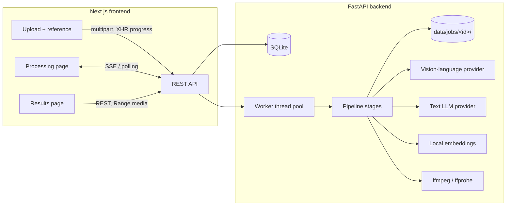

# Architecture

Replay turns a first-person task video into **action steps** (verb + object + tool),
not scene changes or transcript chunks. Everything below serves that idea.

## Components

| Part | Where | Role |
|---|---|---|
| API | `backend/app/api/` | Upload (streaming), job status, SSE, cancel/retry/delete, result, search, exports, demos, Range-enabled media |
| Worker | `backend/app/worker.py` | `ThreadPoolExecutor`; job state persisted in SQLite; live progress kept in memory for SSE; cancellation via events; restart recovery; retention cleanup |
| Pipeline | `backend/app/pipeline/` | One module per stage, each reading and writing artifacts in the job folder, so stages can be re-run and cached |
| Providers | `backend/app/providers/` | `VisionLanguageProvider.describe_window()` and `TextLLMProvider.complete_json()`; mock, Gemini, OpenAI, Anthropic, Ollama |
| Prompts | `backend/app/prompts/*.v1.md` | Versioned Jinja templates; the version is part of the window cache key |
| Frontend | `frontend/app`, `frontend/components` | Landing/upload, processing, results, demos, about, XR |

## Pipeline stages and data flow

Each stage reports progress (stage name and fraction); the overall percentage uses these weights:

| # | Stage | Weight | Reads | Writes |
|---|---|---|---|---|
| 1 | **ingest**: probe, validate, upright/scale/CFR transcode, mono 16 kHz WAV | 10 % | `input.*` | `probe.json`, `work.mp4`, `audio.wav`, `work.json` (input deleted) |
| 2 | **motion**: 4 fps grayscale frame differences, smoothing, adaptive idle spans, PySceneDetect cuts | 10 % | `work.mp4` | `motion.json` |
| 3 | **transcribe**: optional faster-whisper (hint only, never blocks) | 5 % | `audio.wav` | `transcript.json` |
| 4 | **understand**: windows over the non-idle timeline (4 s, stride 3 s, never across a cut), 4 or 8 sharp frames each, VLM → strict JSON action | 45 % | `work.mp4`, `motion.json`, transcript | `frames/`, `windows.json`, `actions.json`, `data/cache/windows/*.json` |
| 5 | **segment**: merge windows into steps (pure functions) | 5 % | `actions.json`, `motion.json` | `steps.json` |
| 6 | **summarize**: titles, phases, task name, summary (LLM, validated, deterministic fallback) | 5 % | `steps.json` | `summary.json` |
| 7 | **align**: reference procedure check (only if one was given) | 5 % | steps, summary | `alignment.json` |
| 8 | **media**: keyframes, per-step clips, highlight reel, search index | 10 % | `work.mp4`, steps, summary | `keyframes/`, `clips/`, `highlights.mp4`, `highlights.jpg`, `search/` |
| 9 | **exports**: versioned result + reports | 5 % | everything | `result.json`, `report.md`, `report.pdf`, `chapters.srt`, `chapters.vtt`, `captions.vtt` + DB rows |

**Resume and retry.** Completed stages are recorded on the job. Each stage short-circuits when
its output already exists, so *Retry* resumes at the stage that failed. The per-window cache
makes re-running understanding free.

**Cancellation.** Every long loop checks a per-job event, and ffmpeg subprocesses are polled
and killed on cancel. On shutdown, running jobs are left "running" and marked *interrupted*
(failed, retryable) on the next start.

## Segmentation rules (windows → steps)

1. Text key per window: `"{verb} {object} with {tool}"` + description, embedded locally.
2. Adjacent windows merge if: same normalised verb+object; **or** cosine ≥ 0.78; **or** gap < 1.5 s and cosine ≥ 0.65.
3. Never merge across a hard cut or an idle span > 3 s.
4. Steps < 2 s are absorbed into the most similar allowed neighbour; low-confidence `unknown` steps < 3 s are dropped.
5. The 1 s window overlap is resolved at its midpoint; shared boundaries move to the nearest local motion minimum within ±1 s (or snap to a nearby cut).
6. Verb/object/tool by confidence-weighted vote; description from the most confident window; peak time = motion maximum.

## Alignment (reference procedure)

1. Parse the reference (one step per line, numbering stripped).
2. Similarity = embeddings of reference steps × detected steps (title + verb/object/tool + description).
3. Hungarian assignment on `1 − similarity`; unmatched detected steps next to their best reference step's match are attached (one-to-many).
4. Similarity < 0.2 is rejected; 0.2–0.45 needs an LLM "does X accomplish Y?" yes.
5. Order: the **longest increasing subsequence** of first-matched detected indices is `done`; other matched steps are `out_of_order`; unmatched reference steps are `missed`; unmatched detected steps are `extra`.
6. Plain-language verdict, e.g. *"6 of 7 steps completed. You skipped 'Chop the chives'."*

## Search

Each step's title, description, verb/object/tool and transcript excerpt are embedded and saved
as `search/vectors.npy` (no vector DB). A query scores
`0.6 × cosine + 0.4 × normalised BM25`, so exact words ("salt") and paraphrases both work.
With `answer=true`, the top hits go to the LLM for a one-sentence answer that cites a timestamp;
the cited time is checked against the hits.

## Result schema (v1.0)

`GET /api/jobs/{id}/result` returns `result.json` (see `backend/app/pipeline/types.py::Result`;
mirrored in `frontend/lib/types.ts`):

- `job_id`, `title`, `task_name`, `summary`, `mock_mode`, `created_at`, `schema_version`
- `video` (URL, duration, size, fps, audio, source codec, rotation, VFR flag)
- `stats` (original and highlight length, compression ratio, step count, idle removed, processing time, windows analysed)
- `phases[]` (name, step range, colour index)
- `steps[]` (times, title, verb/object/tool, hands, description, confidence, phase, transcript, keyframe and clip URLs, alignment status)
- `alignment` (verdict, per-reference status and matched steps, extra steps) or `null`
- `highlight`, `media` (video, chapters VTT, captions VTT, poster), `exports[]`, `transcript[]`
- `under_the_hood` (providers, embedding, prompt version, stage timings, raw windows, idle spans, cuts, motion curve, summary source)

## Security basics

- Upload size enforced while streaming (and by `Content-Length` up front); only UUID paths on disk; original filenames are display-only.
- Per-IP rate limit on job creation (in memory).
- CORS from config (plus a private-network regex for phones on the LAN).
- Media route only serves files inside `data/jobs/<uuid>/`, rejects path traversal and hides internal artifacts.
- Keys only from environment variables; `.env` is gitignored.

## Why these choices

- **Action-centric windows**: 4 s windows match the length of most hand actions; overlap avoids cutting an action in half, and cut-aware windows keep unrelated shots apart.
- **Idle removal first**: first-person footage is full of reaching and waiting; removing it saves most of the VLM cost and gives the compression in the recap.
- **Strict JSON + validation + fallbacks everywhere**: a demo must never break because a model returned prose; each LLM step has a deterministic fallback.
- **Local embeddings + NumPy**: search and merging run offline in milliseconds, without a vector DB service.
- **Files per stage**: easy to debug, cache, resume, and inspect in the "Under the hood" panel.
